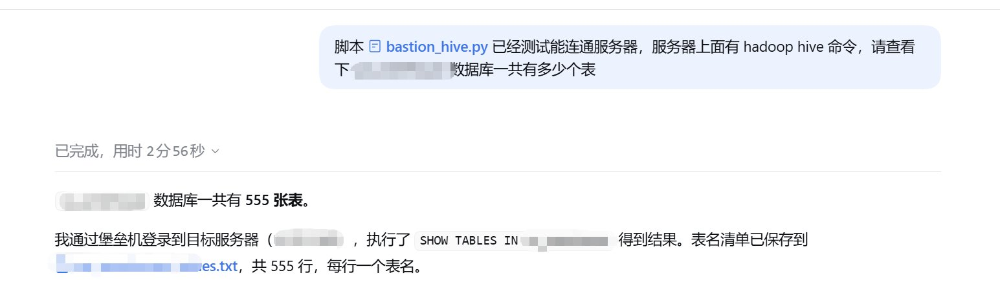
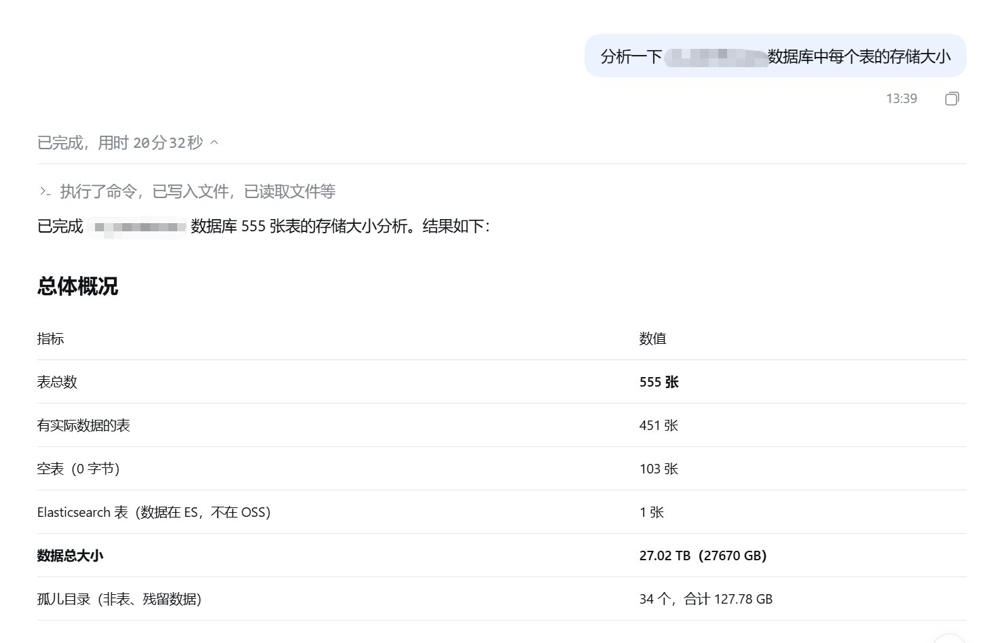

# 背景

先看两张截图，这是同一件事的前后两步

**第一步：** 只丢了一句话过去：脚本 `bastion_hive.py` 已经测试能连通服务器，服务器上面有 hadoop hive 命令，请查看下 xxx 数据库一共有多少张表

```text
已完成，用时 2 分 56 秒

数据库一共有 555 张表

通过堡垒机登录到目标服务器，执行了 SHOW TABLES IN xxx 得到结果
表名清单已保存到 xxx_tables.txt，共 555 行，每行一个表名
```



**第二步：** 接着问了第二句：分析一下这个数据库中每个表的存储大小

```text
已完成，用时 20 分 32 秒

表总数                    555 张
有实际数据的表             451 张
空表（0 字节）             103 张
Elasticsearch 表（数据在 ES，不在 OSS）  1 张
数据总大小                 27.02 TB（27670 GB）
孤儿目录（非表、残留数据）   34 个，合计 127.78 GB
```



27 TB 的盘子，555 张表，还顺带挖出来 127 GB 没人认领的孤儿目录

整个过程没有写一行 SQL，也没有登一次服务器，做的事情只有两件：**把能力交出去，然后提问**

这篇文章就聊聊这背后做了什么

# Agent 缺的从来不是脑子，而是手和眼睛

现在大家手里的模型，推理能力其实早就够用了，写一段 SQL、读一段报错、分析一个目录结构，对它来说都不是难事

但如果你只给它一个聊天框，它能做的就只有"告诉你怎么做"

它不知道你的表叫什么，不知道你的集群有多大，不知道线上服务昨天有没有重启，它只能基于你打出来的那几行字去做推测，然后给你一个听起来很有道理、但落在你的环境里可能完全不对的答案

真正让 Agent 从"顾问"变成"干活的"的，是三个东西：

- 本地计算机的控制权限，能改文件、能跑脚本
- 接入数据集群的能力，能查数据、能看规模
- 云上运维的控制权限，能排查部署服务的问题

把它们理解成手、眼睛和听诊器，有了这三样，它才真正站到了我的工作现场里

# 第一层：本地计算机的控制权

这是最基础的一层，也是收益最直接的一层

所谓本地控制权，说白了就是让 Agent 能执行命令、能读写文件，听起来好像没什么，但它带来的变化是质变的：**它从"给我建议"变成了"替我把事做完"**

上面那个例子里的 `bastion_hive.py` 就是关键道具，这是一个我自己写的堡垒机跳板脚本，里面封装了登录目标服务器、执行 hive 命令、回收结果的完整逻辑

Agent 拿到这个脚本之后，要做的事情变成了：

1. 读一遍脚本，搞清楚怎么调用
2. 试跑一次，确认能连通
3. 把 `SHOW TABLES IN xxx` 拼进去执行
4. 把返回的 555 行结果落盘成 txt
5. 告诉一共多少张表

这五步里，只有第一步和最后一步是"智能"，中间三步都是体力活，而恰恰是这几步体力活，以前需要亲手去做

这里有个小心得：**给 Agent 留一个能自解释的脚本，比自己写一长串操作步骤更有效**，脚本本身就是最好的文档，它读完就知道参数怎么传、返回什么格式

# 第二层：接进数据集群

只有本地控制权还不够，因为真正的答案在集群里

第二层要解决的是"看得见数据"，对做数据的人来说，这意味着 Agent 能连上 Hive、能用 hdfs 命令、能读到真实的数据规模

这一步做完之后，问法就完全不一样了

以前只能问："怎么统计 Hive 表的存储大小？"

现在可以直接问："分析一下这个数据库中每个表的存储大小"

区别在哪里？在于第二种问法里，**执行路径是 Agent 自己找出来的**

它需要自己决定用 `hdfs dfs -du` 还是用 Hive 的元数据，需要处理 555 张表跑一遍时间太长的问题，需要在 20 分钟里保持住上下文不丢

最后交出来的那份结果，信息量其实远超我原本的预期：

- 451 张有数据的表，103 张空表 —— 说明这个库有不少历史遗留
- 1 张表数据在 Elasticsearch 不在 OSS —— 说明血缘不是单一路径
- 34 个孤儿目录占了 127.78 GB —— 这是真正能省下成本的地方

**最后这一条，才是原本没想到要问的**，给它的任务只是"分析每个表的存储大小"，孤儿目录是它在执行过程中自己发现的异常

这就是接进集群的价值：它不只是替我执行，还能在真实数据里看见没让它找的东西


代码没什么花哨的，重点在于**它把一团文本变成了结构化数据**，Agent 拿到 DataFrame 之后，想按大小排序、想筛选空表、想算总盘子，都是顺手的事

# 第三层：云上运维的控制权

数据集群管的是"数据在哪"，云上运维管的是"服务活没活着"

这一层是觉得最容易被忽略、但实际价值最高的一层

原因是：**线上问题的排查，本质上是信息收集，而信息收集是最适合交给 Agent 的部分**

以前服务报警了，流程大概是：登录控制台，看监控曲线，翻日志，查 Pod 状态，确认部署版本，找到异常时间点，再去捞对应的日志片段。这一套动作熟练工也要十几分钟，而且大部分时间花在"点来点去"和"想起来要去看哪里"

把云上的运维控制权限交给 Agent 之后，这套流程变成了：

- 先看服务整体状态和最近一次部署时间
- 拉出最近一段时间的错误日志
- 对比异常时间点和部署时间点是否吻合
- 检查资源水位，排除是不是被挤死了
- 把结论和证据一起给

它做得快，不是因为它聪明，而是因为它**不会漏**，人查问题查累了会跳步骤，Agent 不会

# 真正的关键：操作上下文 + 循环

上面三层能力，其实都还只是"装备"，真正让整件事跑起来的是第四点：**操作上下文**

什么叫操作上下文？就是输入的命令、命令的输出、以及出错的日志，这三样东西全部留在对话里，成为下一轮的输入

这就是 Agent 和"命令行工具"最本质的区别

举个真实的例子：上面 `bastion_hive.py` 那一步，Agent 第一次执行大概率是失败的——可能密码不对，可能跳板机 IP 变了，可能 hive 命令路径不在 PATH 里

传统工具到这里就结束了，给你一个 `Exception` 就完事

但 Agent 会拿到这段报错，然后：

```text
[第 1 轮] 执行 hive -e "SHOW TABLES IN ods_db"
        失败：ls: cannot access '/user/hive/warehouse/ods_db.db': No such file

[第 2 轮] 报错说明库名可能不对，先执行 SHOW DATABASES 看看有哪些库
        成功：default / ods_db_v2 / dim_db ...

[第 3 轮] 库名是 ods_db_v2，换成正确的库名重新执行
        成功：555 行表名
```

这个循环，就是 Agent 的引擎

用代码表达出来大概是这样，核心逻辑只有二十来行

```python
import subprocess


def run_command(command, timeout=60):
    """执行一条命令，把 输入 / 输出 / 错误 三件套收集成上下文"""
    result = subprocess.run(
        command,
        shell=True,
        capture_output=True,
        text=True,
        encoding="utf-8",
        errors="replace",
        timeout=timeout,
    )
    return {
        "command": command,
        "exit_code": result.returncode,
        "stdout": (result.stdout or "").strip(),
        "stderr": (result.stderr or "").strip(),
    }


def agent_loop(task, plan, max_rounds=5):
    """按计划执行命令，失败就把错误信息留在上下文里，供下一轮参考"""
    context = []
    for i, command in enumerate(plan, start=1):
        if i > max_rounds:
            print(f"达到最大轮次 {max_rounds}，停止")
            break
        record = run_command(command)
        context.append(record)
        if record["exit_code"] != 0:
            # 报错的最后一行通常最关键，只取它，避免上下文被 traceback 淹没
            lines = record["stderr"].splitlines()
            print(f"[第 {i} 轮] 执行失败：{lines[-1] if lines else 'exit ' + str(record['exit_code'])}")
            continue
        print(f"[第 {i} 轮] 执行成功：{record['stdout']}")
    return context


if __name__ == "__main__":
    plan = [
        "echo 第一步先确认环境",
        # 这一步会失败：库目录不存在
        "cd /user/hive/warehouse/ods_db.db",
        "echo 换个思路继续",
    ]
    agent_loop("确认库目录是否存在", plan)
```

在服务器的 bash 里跑出来是这样，你能看到失败信息并没有让流程中断，而是变成了下一轮的线索

```text
[第 1 轮] 执行成功：第一步先确认环境
[第 2 轮] 执行失败：bash: cd: /user/hive/warehouse/ods_db.db: No such file or directory
[第 3 轮] 执行成功：换个思路继续
```

注意这里的 `encoding="utf-8"` 和 `errors="replace"`，这两个参数不是凑数的，而是在 Windows 上第一次写这段就踩了坑：不加显式编码，抓到的 stdout 会因为 GBK 解码失败直接抛 `UnicodeDecodeError`，`result.stdout` 变成 `None`，然后整个循环崩掉

**一个 Agent 的循环跑不稳，往往不是因为模型不行，而是因为工具层的边界没处理干净**

# 一点体会

回过头看那两张截图，2 分 56 秒查出 555 张表，20 分 32 秒盘完 27 TB 存量和 127 GB 孤儿目录

放在以前，这件事如果自己做，光是把 555 张表的 `hdfs dfs -du` 跑一遍、再汇总成能看的表，就得花掉大半天

但真正的变化不在省下来的那几个小时，而在于**提问题的层次变了**

以前会想："这个需求值不值得做，做起来要多久" 所以很多想知道但又不那么急的事，就一直搁着

现在会想："先问问看" 因为成本已经低到可以随口一问

这大概就是给 Agent 装上手脚之后，最容易被低估的收益：**不是把旧活干得更快，而是让原本根本不会发生的探索，变成顺手就能做的一件事**

而 127 GB 的孤儿目录，就是这么被顺手发现的

不过有句话还得补上：**给能力的同时，一定要留一脚刹车**

三层权限全交出去，风险是实打实的——它能删你的表，也能重启你的服务，所以权限必须收着给。目前 Agent 管的还基本限于本地，跑在沙箱里，边界相对清楚；可一旦伸到远程数据集群和线上运维，安全就不只是加几条规则能兜住的了，还得靠后续独立的方案去补齐

听着像是束手束脚，但正好相反：**正因为有了刹车，才敢把马力开大**，不放心的从来不是模型，而是"没人看着"，把这几条守住，反而更愿意让它多干一点


# 历史相关文章
- [1度电，到底能炼出多少Tokens](../../随笔/20260506-1度电，到底能炼出多少Tokens/)
- [Python 基于hdfs路径统计hive表存储信息](../../Python数据处理/Python-基于hdfs路径统计hive表存储信息/)

**************************************************************************
**以上是自己实践中遇到的一些问题，分享出来供大家参考学习，欢迎关注微信公众号：DataShare ，不定期分享干货**


