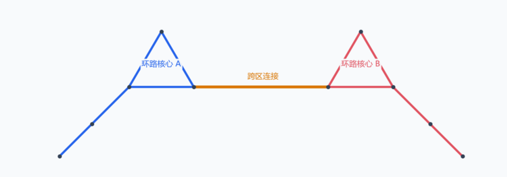
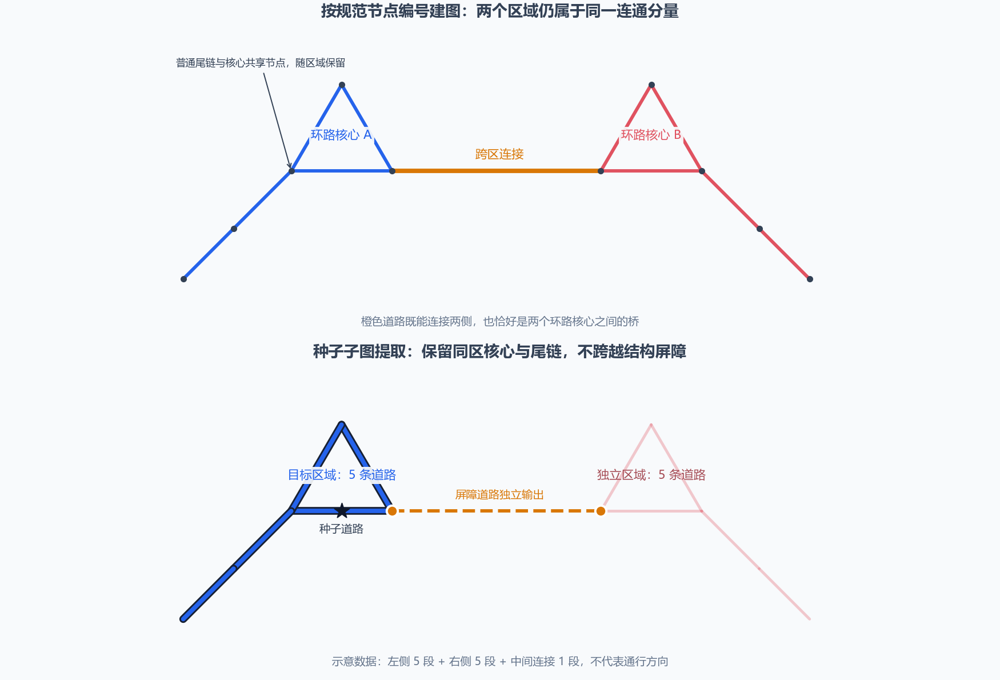

# 背景

在道路数据分析中，经常需要从一批道路明细中提取一组关联道路

例如，高速服务区两侧分别有主线、内部环路和停车支路，中间通过一条道路连接，给定某一侧的一条种子道路，希望尽量提取这一侧的关联路网，用于后续统计、空间分析或样本构建

**两片道路区域虽然各自相对独立，却可能通过一条通道进行连接**



直接遍历整个连通分量会把两侧一起纳入，如果遇到分叉就停止又会遗漏区域内部道路

这篇文章从数据挖掘工程师的角度，介绍如何用桥边、桥树和环路核心识别结构边界，再以种子道路提取对应区域

> 所有代码均使用 Python，验证环境为 Python 3.11、NetworkX 3.6.1，示例与测试采用合成路网，本文是既有图算法在道路集合提取任务中的组合应用，不是新的基础图算法


# 一、先定义任务：要的是区域，不是一条路线

**输入**是一份分析范围确定的规道路数据，以及其中一条种子道路

**输出**是种子所在结构区域的道路键集合，区域内部的主线延伸、普通分叉和挂接支路都可以纳入，区域间连接道路独立处理

| 分析问题                     | 本文处理口径             |
| ---------------------------- | ------------------------ |
| 种子道路属于哪一片关联路网   | 提取对应区域的道路集合   |
| 区域内部存在普通分叉         | 不因为分叉而截断         |
| 两个环路核心只由桥式通道连接 | 识别通道边界，不跨区遍历 |
| 种子本身就是区域间连接道路   | 仅返回这条道路           |
| 没有识别到结构边界           | 返回种子所在整个连通区域 |
| 车辆从 A 到 B 的最短路线     | 不属于本文目标           |
| 识别真实高速上行、下行       | 不作方向语义判断         |

因此，图模型采用**无向图**，起终点字段用于定义边的两个端点，不解释为车辆通行方向

最终产物是一个道路集合，不是一条按行驶次序排列的导航路径

# 二、为什么直接遍历和分叉截断都不够

## 1. 连通性只回答能否到达

只要中间通道存在，两侧道路就可能互相可达

BFS（广度优先搜索，Breadth-First Search）或 DFS（深度优先搜索，Depth-First Search） 从一侧出发，遍历整个连通分量，必然会经过连接通道进入另一侧

遍历算法没有错，只是“**道路全部可达**“ 比“本次想分析的区域” 更大

## 2. 分叉不一定是区域边界

服务区内部的出入口、停车支路和环形通道都会形成多路节点

如果一遇到两个以上候选道路就停止，一个完整区域就会被切成很多小段

**区域内部的普通分叉，与连接两个区域的通道，是不同层次的结构特征**

## 3. 结构规则比限制邻域更符合这个目标

距离和层数适合提取固定邻域，却会截断较长的挂接道路

转角、名称和道路类型评分可以表达连续性偏好，但不必然等于区域归属

本案例采用的结构假设是

**如果两片内部含环路的路网仅由桥式通道连接，那么可以把通道当作区域间边界**

这条规则不要求预先指定区域数量，也不按路名或方向打分，但它仍然是一条有适用范围的领域假设

# 三、建图：一条道路对应一条边

## 1. 最小输入只有三个字段

| 字段    | 作用                  |
| ------- | --------------------- |
| `rid` | 道路 ID，标识道路记录 |
| `sid` | 起点节点号            |
| `eid` | 终点节点号            |

字段名均为示意命名，不对应真实业务表字段，示例结构如下

```python
example_road = {
    "rid": "road_01",
    "sid": "node_A",
    "eid": "node_B",
}
```

连接关系完全由节点编号确定，不需要额外的几何字段参与判断

节点号以字符串传递，保留前导零和大整数标识

道路 `rid` 用于区分不同路段，也作为结果回连的道路键，不参与端点之间的连接判断

### 2. 为什么使用无向多重图

两条不同道路可能连接同一对节点，普通 `Graph` 会把它们合成一条边，导致道路明细丢失，也会改变环路判断

因此使用 `MultiGraph`，保留平行边和自环，每条边都有对应的稳定道路键

## 3. Python 实现

需要先安装 `NetworkX` 依赖

```python
from collections import deque
from typing import Any

import networkx as nx

RoadKey = str

def build_graph(rows: list[dict[str, Any]]) -> nx.MultiGraph:
    graph = nx.MultiGraph()
    roads = {}
    endpoints = {}
    for row in rows:
        key = str(row["rid"])
        if key in roads:
            if roads[key] != row:
                raise ValueError(f"已经存在道路记录，道路id: {key}")
            continue
        node_ids = (row["sid"], row["eid"])
        if any(not isinstance(node, str) or not node.strip() for node in node_ids):
            raise ValueError("节点id不能为空")
        start, end = node_ids
        graph.add_edge(start, end, key=key)
        roads[key] = row
        endpoints[key] = (start, end)
    graph.graph["roads"] = roads
    graph.graph["endpoints"] = endpoints
    return graph
```

代码保留了道路键到原始明细、道路键到两端节点的映射，方便结果回连

同一条记录重复输入时只计一次，相同道路键对应不同记录时直接报错，避免静默覆盖

这里的少量检查只是输入契约保护，不扩展为数据清洗流程，后续分析都基于节点编号

# 四、桥边：连接瓶颈只是候选边界

图论中的桥边，也叫割边，删除后会使连通分量数量增加，不是现实中的高架桥

两片内部路网如果只通过一条道路连接，这条道路就是桥边

但普通直链上的每条边，也可能都是桥边

如果把所有桥边都屏蔽，主线延伸和末端支路就会被切成一段段，区域仍然提取不完整

**所以需要进一步区分：桥的一侧只是普通尾链，还是桥的两侧都有内部核心**



图中只展示合成拓扑，颜色区分结构区域

# 五、桥树分解：只屏蔽核心之间的通道

## 1. 临时移除全部桥边

在图副本中移除全部桥边，计算剩余连通块

这里是按桥边分解，不是删除割点形成的点双连通分解，两者不要混用

暂时移除桥边只是为了分析，不能把所有被移除的道路都当作最终屏障

## 2. 找到含环路的内部块

对一个连通块，设节点数为 V、边数为 E，`E - V + 1` 是独立环数量，大于 0 就说明它含环路

本文把这样的块标记为“**环路核心**”

这个标签不表示识别出了服务区实体，只是在描述连通块的结构

自环和平行边同样参与图论环路计数，所以前面需要保留多重图

## 3. 压缩成桥森林

每个非桥连通块压缩成一个大节点，原来的桥边保留在这些大节点之间

每个原始连通分量对应一棵桥树，原图不连通时，整体就是桥森林

在这个更小的结构上，我们只需要关心每个块是否含环路核心，以及块之间如何连接

## 4. 根据两侧核心数量筛选屏障

对桥树中的一条边，判断删除它后，两侧是否都含环路核心

- 两侧都有核心，设为区域间屏障
- 一侧只有普通树枝，不设为屏障，尾链仍与所属区域一起提取

设整棵树的核心总数为 `total_cores`，某条父子边下方的子树核心数为 `count`，屏障条件就是

**`0 < count < total_cores`**

只需一次父子遍历和逆序累加，就能判断全部桥边，不需要逐条删除桥边再反复遍历整图

两个核心之间如果通过多段桥式通道连接，通道中的每条桥边都会成为屏障，不强行把中间道路归给某一侧

## 5. Python 实现

```python
def find_barriers(graph: nx.MultiGraph) -> set[RoadKey]:
    bridges = [
        (u, v, next(iter(graph[u][v])))
        for u, v in nx.bridges(graph)
    ]
    without_bridges = graph.copy()
    without_bridges.remove_edges_from(bridges)

    blocks = list(nx.connected_components(without_bridges))
    block_of = {}
    core = {}
    for block_id, nodes in enumerate(blocks):
        for node in nodes:
            block_of[node] = block_id
        block = without_bridges.subgraph(nodes)
        core[block_id] = block.number_of_edges() - block.number_of_nodes() + 1 > 0

    forest = nx.Graph()
    forest.add_nodes_from(range(len(blocks)))
    for u, v, key in bridges:
        forest.add_edge(block_of[u], block_of[v], road=key)

    barriers = set()
    for component in nx.connected_components(forest):
        root = next(iter(component))
        order = [root]
        parent = {root: None}
        for node in order:
            for neighbor in forest[node]:
                if neighbor not in parent:
                    parent[neighbor] = node
                    order.append(neighbor)

        subtree_cores = {node: int(core[node]) for node in order}
        total_cores = sum(subtree_cores.values())
        for child in reversed(order[1:]):
            ancestor = parent[child]
            count = subtree_cores[child]
            if 0 < count < total_cores:
                barriers.add(forest[ancestor][child]["road"])
            subtree_cores[ancestor] += count
    return barriers
```

`nx.bridges()` 返回桥边两端节点，不直接返回道路键，所以从 `graph[u][v]` 取回道路键

只有确认是桥边时才这样取值，因为平行边能提供替代连接，不会作为单独桥边返回

函数输出的是**最终屏障集合**，不是全部桥边集合，普通挂接尾链虽然可能由桥边组成，仍然可以随区域保留

# 六、从种子道路提取区域子图

有了屏障集合以后，提取规则可以保持简单

1. 普通道路作为种子时，遍历不经过屏障的可达道路
2. 屏障道路作为种子时，仅返回自身
3. 没有屏障的连通分量，整体作为一个区域
4. 结果按道路键去重，不附带行驶次序

函数只接收图、屏障和种子道路键，不按距离、层数或固定条数截断结果

```python
def extract_region(
    graph: nx.MultiGraph,
    barriers: set[RoadKey],
    seed: RoadKey,
) -> set[RoadKey]:
    if seed not in graph.graph["roads"]:
        raise KeyError(seed)
    if seed in barriers:
        return {seed}

    start, end = graph.graph["endpoints"][seed]
    queue = deque({start, end})
    visited_nodes = {start, end}
    reached = {seed}
    while queue:
        node = queue.popleft()
        for neighbor, parallel_edges in graph[node].items():
            for key in parallel_edges:
                if key in barriers:
                    continue
                reached.add(key)
                if neighbor not in visited_nodes:
                    visited_nodes.add(neighbor)
                    queue.append(neighbor)
    return reached
```

原图没有被删除或改写，屏障只是遍历时的一组边约束，返回的道路键可与源明细回连，得到下游分析数据集

如果需要子图对象，应按道路边键提取，而不是只取节点诱导子图，否则后续合并区域的节点时，可能把原本要排除的连接边重新带回来

**没有识别到屏障时，输出整个连通区域只是约定的退化策略，不等于确认这就是单侧道路区域**

建议在分析结果中保留是否存在结构边界的标记

# 七、用一组路网完整复现

示例包含两个三角形核心，每侧挂两条尾部道路，中间只有一条连接道路

所有道路共享节点时都使用同一节点编号，无需其他连接规则

```python
def demo_rows() -> list[dict[str, Any]]:
    connections = [
        ("L_AB", "LA", "LB"), ("L_BC", "LB", "LC"),
        ("L_CA", "LC", "LA"), ("L_tail1", "LA", "LT"),
        ("L_tail2", "LT", "LU"), ("cross", "LB", "RB"),
        ("R_AB", "RA", "RB"), ("R_BC", "RB", "RC"),
        ("R_CA", "RC", "RA"), ("R_tail1", "RA", "RT"),
        ("R_tail2", "RT", "RU"),
    ]
    return [
        {"rid": key, "sid": start, "eid": end}
        for key, start, end in connections
    ]


def demo() -> None:
    rows = demo_rows()
    graph = build_graph(rows)
    barriers = find_barriers(graph)
    left = extract_region(graph, barriers, "L_AB")
    right = extract_region(graph, barriers, "R_AB")
    cross = extract_region(graph, barriers, "cross")
    print("barriers:", sorted(barriers))
    print("left:", sorted(left))
    print("right:", sorted(right))
    print("cross:", sorted(cross))
```

预期结果如下

| 输出             | 结构结果                       |
| ---------------- | ------------------------------ |
| 全部道路         | 11 条                          |
| 左侧区域         | 3 条核心边 + 2 条尾链，共 5 条 |
| 右侧区域         | 3 条核心边 + 2 条尾链，共 5 条 |
| 屏障集合         | 只有 `cross`                 |
| 连接道路作为种子 | 仅返回 `cross`               |

可以直接检查道路集合之间的关系

```python
graph = build_graph(demo_rows())
barriers = find_barriers(graph)
left = extract_region(graph, barriers, "L_AB")
right = extract_region(graph, barriers, "R_AB")

assert len(left) == 5
assert len(right) == 5
assert left.isdisjoint(right)
assert "cross" not in left | right
assert left | right | barriers == set(graph.graph["roads"])
assert extract_region(graph, barriers, "cross") == {"cross"}
assert extract_region(graph, barriers, "L_tail2") == left

demo()
# barriers: ['cross']
# left: ['L_AB', 'L_BC', 'L_CA', 'L_tail1', 'L_tail2']
# right: ['R_AB', 'R_BC', 'R_CA', 'R_tail1', 'R_tail2']
# cross: ['cross']
```

我们没有预设两侧各有多少条道路，核心、尾链和连接道路的归属由图结构规则共同决定

同一区域任意一条道路作为种子，包括末端支路，都应得到同一组道路，这比只验证一条核心道路更充分

# 八、方法边界：结构分区不等于道路语义

## 1. 两侧有多条替代连接

如果两个区域之间存在替代路径，中间道路可能不再是桥，就无法形成预期屏障

按约定输出整个连通区域时，应明确标记未识别结构边界，结果可能同时包含两侧道路

## 2. 同一业务区中有多个核心

同一业务区内部的两个环路核心，如果仅由桥式通道连接，也可能被进一步拆开

## 3. 只有一个核心，或者完全无环

这类分量不会产生核心间屏障，内部所有普通分叉和树枝都会属于同一个可提取区域

这既是保留尾链的原因，也是方法无法进一步划分这类网络的原因

## 4. 输入范围会改变结构

范围截取可能切断环路，类型过滤可能移除内部连接，输入数据更新也可能改变拓扑

## 5. 不判断方向

本文按可靠节点编号建立无向连接，只提取道路关联结构，不识别车辆能否合法通行，也不自动标注上行或下行

导航和通行分析需要另外的方向与转向约束，不属于当前任务

# 总结

道路拓扑数据中，问题的关键不是“还能向外扩几层”，而是“哪些连接应该被视为区域边界”

这套方法分成三个层次

1. **图建模**，仅按节点编号准确表达道路连接
2. **结构分析**，用桥森林区分普通尾链与核心间通道
3. **集合提取**，从种子得到完整区域，并用可重复测试验证成员

桥边检测找到候选瓶颈，环路核心提供两侧结构信息，桥树把边界判断转成清晰的统计规则

最终得到的不是万能导航算法，而是一套结构清晰、结果可解释、能够真实使用的道路区域提取方法


# 历史相关文章
- [利用熵值法确定指标权重   原理及Python实现](../../数据分析与挖掘/利用熵值法确定指标权重---原理及Python实现/)
- [Python揭秘：北京2026新能源家庭指标，花落谁家？](../../数据分析与挖掘/20260605-Python揭秘：北京2026新能源家庭指标，花落谁家？/)


**************************************************************************
**以上是自己实践中遇到的一些问题，分享出来供大家参考学习，欢迎关注微信公众号：DataShare ，不定期分享干货**


